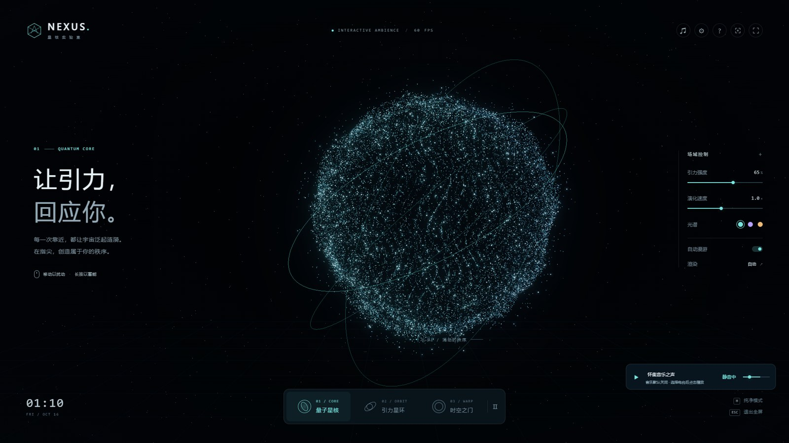
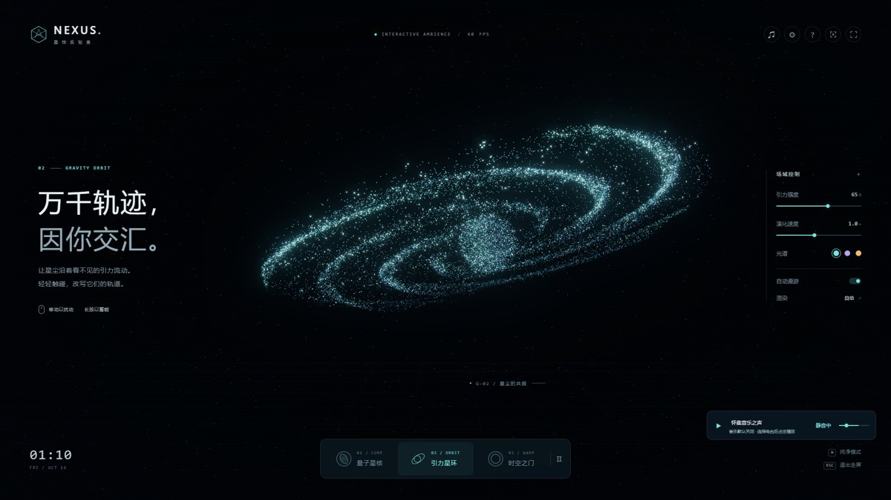
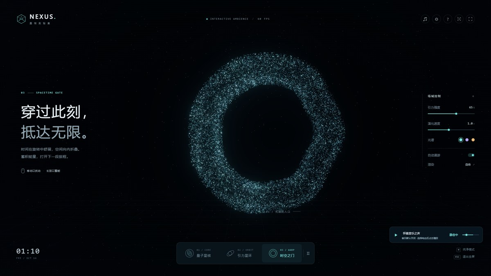
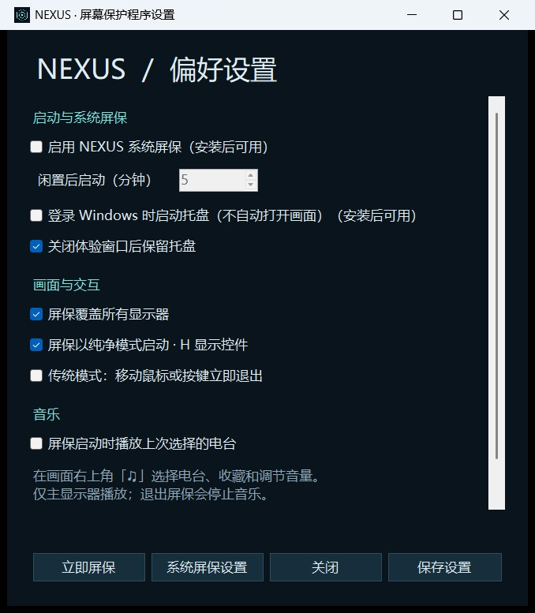
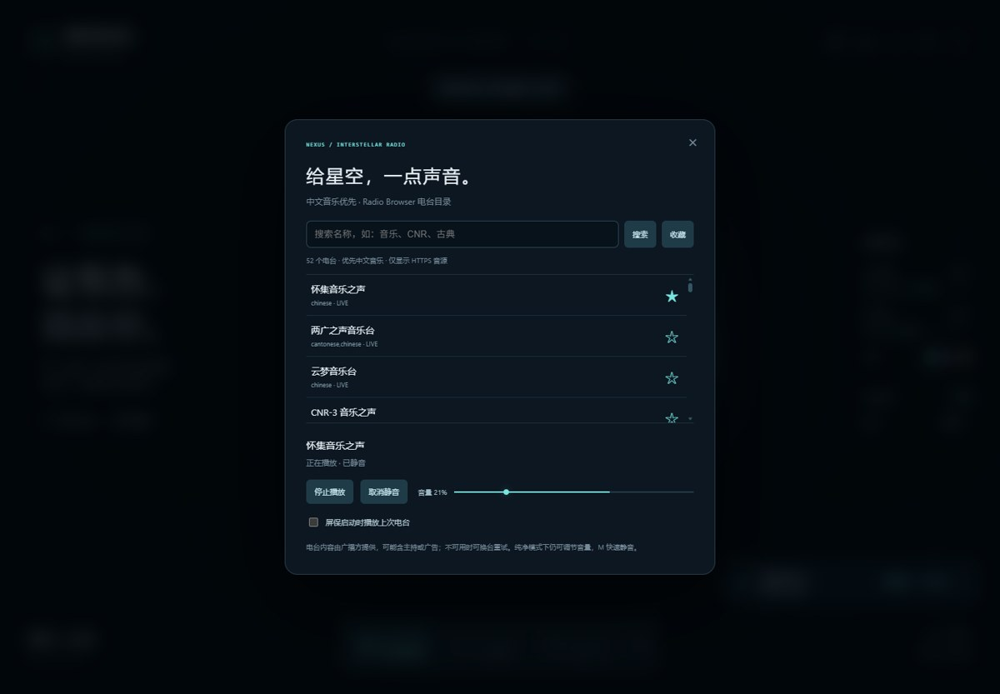
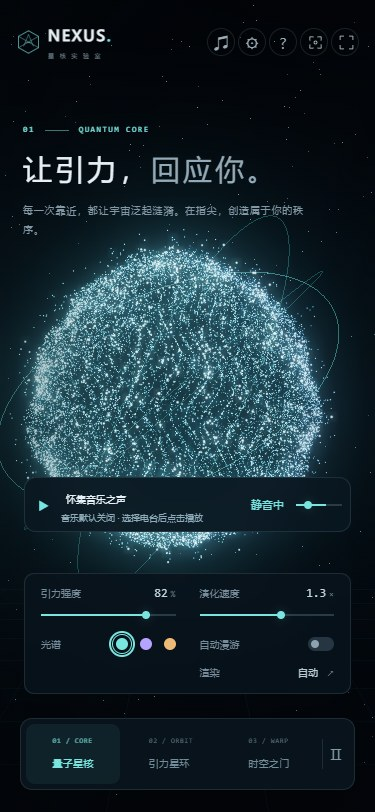

<div align="center">

# NEXUS · 星核实验室

**让引力，回应你。**

适用于 Windows 的交互式三维粒子屏保，让闲置屏幕变成可以触碰的星空。


[](https://github.com/wangdut/nexus-screensaver/releases/latest)
[](https://github.com/wangdut/nexus-screensaver/actions/workflows/build.yml)

[**下载 v1.1 Windows 完整包**](https://github.com/wangdut/nexus-screensaver/releases/download/v1.1.0/NEXUS-Windows-x64-v1.1.zip) · [使用指南](docs/USER_GUIDE.md) · [更新记录](CHANGELOG.md) · [反馈问题](https://github.com/wangdut/nexus-screensaver/issues)



</div>

## 一颗星核，三种形态

鼠标靠近，粒子随引力涌动；长按蓄能，再释放一圈能量波。你可以旋转视角、改变光谱和演化速度，也可以隐藏界面，让星空自行漫游。

| 量子星核 | 引力星环 | 时空之门 |
| :--- | :--- | :--- |
| 聚拢与呼吸的星尘球体 | 倾斜轨道中的粒子星环 | 向纵深延伸的空间隧道 |
| 按 1 切换 | 按 2 切换 | 按 3 切换 |

| 引力星环 | 时空之门 |
| :---: | :---: |
|  |  |

## 不止好看，也能日常使用

- **真正的 Windows 屏保**：支持闲置后全屏、多显示器、系统设置入口及嵌入式预览。
- **随手可用的托盘**：通知区域图标，右键调整偏好、打开交互体验、立即屏保或退出。
- **安装与卸载完整**：当前用户安装，无需管理员权限；支持控制面板卸载、开始菜单入口和保留偏好升级。
- **按你的习惯启动**：闲置时间 1–240 分钟可调；登录自启动托盘、纯净模式和传统输入即退出均可选。
- **给星空一点声音**：中文音乐电台优先，搜索、收藏、音量、静音和纯净模式迷你播放器。
- **适配不同屏幕**：宽屏、超宽屏、竖屏与窄窗口响应式布局；自动画质、节能模式及减少动态效果支持。

## 三步开始

1. 从 [Releases](https://github.com/wangdut/nexus-screensaver/releases/latest) 下载 **NEXUS-Windows-x64-v1.1.zip**，完整解压。请不要下载 Source code 作为安装包。
2. 双击 **Install.cmd**。安装完成后打开偏好设置，默认闲置 **5 分钟**启动屏保。
3. 调整闲置时间、启动方式等选项并保存。想听音乐，进入体验画面，点击右上角 **♫** 选择电台。

只想先看看？解压后直接双击 **Nexus.exe** 或 **Launch.cmd**，即可便携体验。请保留程序旁的 DLL 和 web 文件夹，不要单独移动 exe / scr。

> 运行环境：**Windows 10 / 11 x64、.NET Framework 4.8、Microsoft Edge WebView2 Runtime、支持 WebGL 2 的显卡**。普通使用不需要 Node.js 或 .NET SDK。缺少 WebView2 时，请安装 [微软官方运行时](https://developer.microsoft.com/microsoft-edge/webview2/)。

## 托盘与偏好设置

双击启动程序**不会自动开启开机启动**。安装后可勾选「登录 Windows 时启动托盘」，只启动后台托盘，不自动打开画面或播放音乐。

系统屏保由 Windows 独立触发：安装并启用后，重启也不需要再次双击；退出托盘不会停用闲置屏保。通知区域图标可能位于 Windows 的隐藏图标菜单中。

<p align="center">
  
</p>

截图为便携体验状态，安装后即可启用系统屏保与登录自启动选项。

## 星际电台

通过 [Radio Browser](https://www.radio-browser.info/) 公共 API 获取电台，无需申请密钥。默认优先展示中文音乐，可搜索电台名称、收藏常听频道，并记住音量与静音状态。



- 音乐默认关闭。选择电台后，可自选「屏保启动时播放上次电台」。
- 纯净模式保留迷你播放器；按 **M** 静音或取消静音。
- 仅主显示器播放，跨窗口避免叠音，退出屏保停止声音，系统小预览不播放。
- 支持设备可解码的 MP3/AAC 与 HLS；仅列出 HTTPS 音源。
- 断网时可查看带日期的目录缓存；收听仍需联网。电台可能有主持、广告、地区或跨域限制，不保证所有音源始终可用。

视觉场景离线运行；电台目录、点击统计与广播流按需联网，不附带或下载音乐文件。

## 操作速查

| 操作 | 功能 |
| :--- | :--- |
| 鼠标移动 / 触摸 | 局部引力扰动 |
| 长按再释放 | 聚拢星尘、释放能量波 |
| 拖动 / 滑动 | 旋转视角 |
| 1 / 2 / 3 | 切换星核 / 星环 / 时空之门 |
| 空格 | 暂停 / 继续演化 |
| H | 纯净模式 / 显示控件 |
| F | 体验窗口切换全屏 |
| M | 静音 / 取消静音 |
| ? | 操作指南 |
| Esc | 关闭弹窗、退出全屏或退出屏保 |

## 屏幕与性能

场景按视口与像素比重新构图，限制高分屏渲染倍率。自动画质在持续低帧率时降低负载；精细模式最多 30,000 个动态粒子，节能模式 16,000 个并关闭辉光。自动漫游每 75 秒切换形态。

已检查 1920×1080、1366×768、3440×1440、3840×2160、768×1024、375×812、320×568 和 800×480。多台物理显示器、不同显卡及混合 DPI 环境仍需在对应设备验证。

<details>
<summary>查看窄屏布局</summary>



</details>

## 常见问题

**在哪里卸载？** 安装后，在「控制面板 → 程序和功能」或「设置 → 应用」卸载 NEXUS，也可运行 Uninstall.cmd。移除应用与启动项；当前屏保仍为 NEXUS 时恢复原屏保。收藏和个人偏好保留。

**怎样升级？** 完整解压新版本并运行 Install.cmd，保留闲置时间、屏保启用状态及偏好。

**为什么按键后进入锁屏？** 恢复时显示登录屏幕、休眠和组织策略由 Windows 管理。NEXUS 不修改锁屏策略，也不替代安全锁屏；需要持续互动时可使用体验窗口的全屏模式。

**发布包包含系统运行时吗？** 不包含 .NET Framework 和 WebView2 Runtime。依赖要求及更多操作见 [完整使用指南](docs/USER_GUIDE.md)。

## 开发与构建

技术栈：**Three.js + WebGL 2 + hls.js + C# WinForms + WebView2**。

在 Windows 项目目录中执行：

```powershell
git clone https://github.com/wangdut/nexus-screensaver.git
cd nexus-screensaver
npm ci
npm run build
npm run dev
```

构建使用 Windows 自带的 .NET Framework C# 编译器；首次构建从 NuGet 获取固定版本 WebView2 SDK。开发预览默认位于 http://127.0.0.1:4173 。

| 路径 | 内容 |
| :--- | :--- |
| web/ | 粒子场景、响应式界面、电台播放器 |
| src/ | Windows 宿主、托盘、系统设置及电台桥接 |
| scripts/ | 构建、安装、卸载与白名单打包 |
| tests/ | 网页交互、Windows 集成及发布包验证 |
| docs/ | 中文使用指南与实机截图 |

```powershell
# 开发服务器运行时，在另一终端检查网页
npm test
node tests/radio.cjs

# Windows 系统集成检查
powershell -ExecutionPolicy Bypass -File tests/settings.ps1
powershell -ExecutionPolicy Bypass -File tests/installer.ps1
powershell -ExecutionPolicy Bypass -File tests/native.ps1
powershell -ExecutionPolicy Bypass -File tests/tray.ps1
powershell -ExecutionPolicy Bypass -File tests/native-audio.ps1

# 生成并检查完整发布包
powershell -ExecutionPolicy Bypass -File scripts/package.ps1
powershell -ExecutionPolicy Bypass -File tests/release.ps1
```

**v1.1 发布前完成 47 项本地检查**，包括实际 MP3 / HLS 静音解码、托盘单实例、设置持久化、安装升级卸载及解压运行。安装与设置测试使用隔离注册表分支。GitHub Actions 检查 Windows 构建、隔离设置与安装流程；图形桌面和实时电台测试在本地执行。

## 反馈与致谢

欢迎提交 [Issue](https://github.com/wangdut/nexus-screensaver/issues) 或 [Pull Request](https://github.com/wangdut/nexus-screensaver/pulls)，参与方式见 [贡献指南](CONTRIBUTING.md)。

感谢 [Three.js](https://threejs.org/)、[hls.js](https://github.com/video-dev/hls.js)、[Microsoft WebView2](https://developer.microsoft.com/microsoft-edge/webview2/) 与 [Radio Browser](https://www.radio-browser.info/)。第三方许可证见 [THIRD-PARTY-NOTICES.txt](THIRD-PARTY-NOTICES.txt) 和发布包 licenses 目录。
